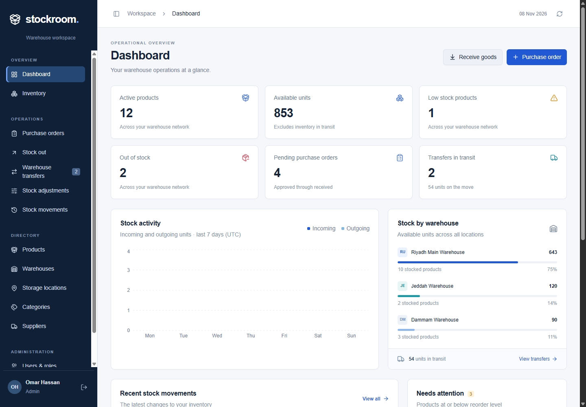
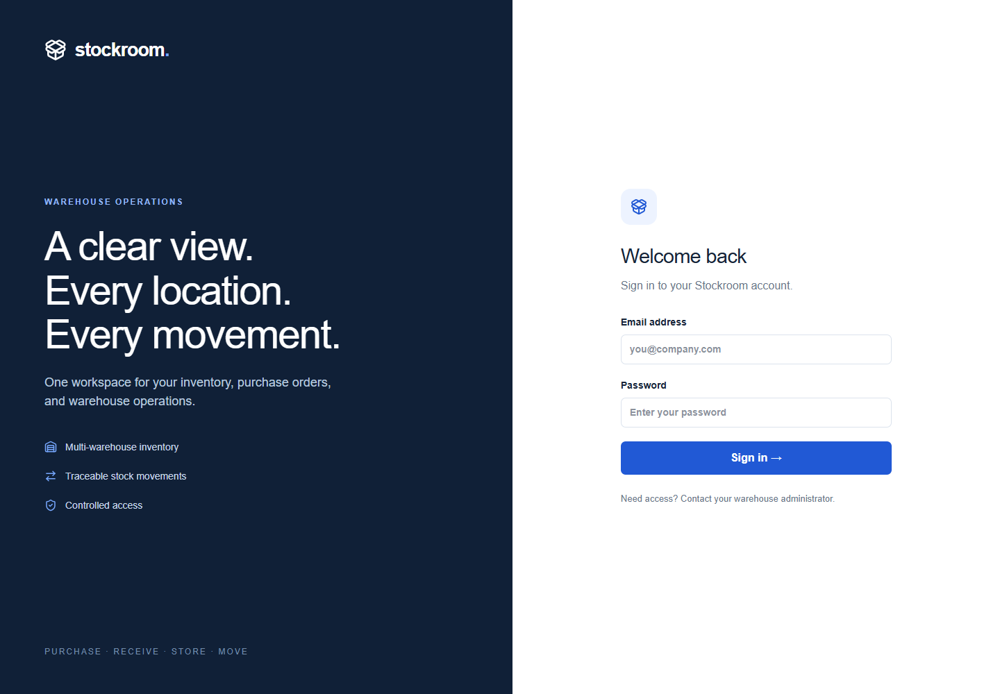
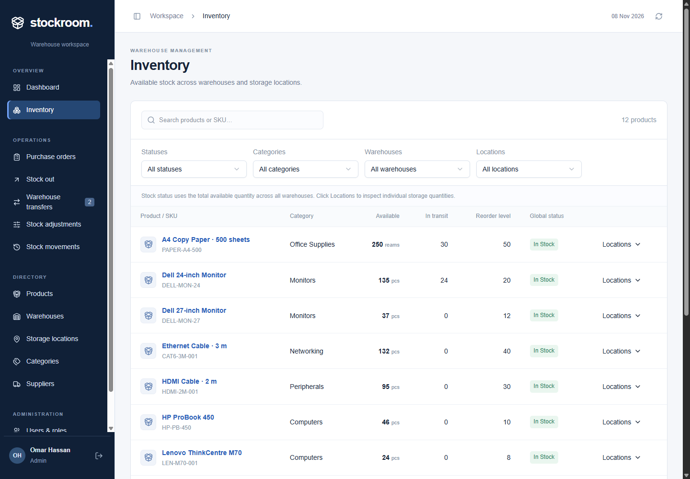
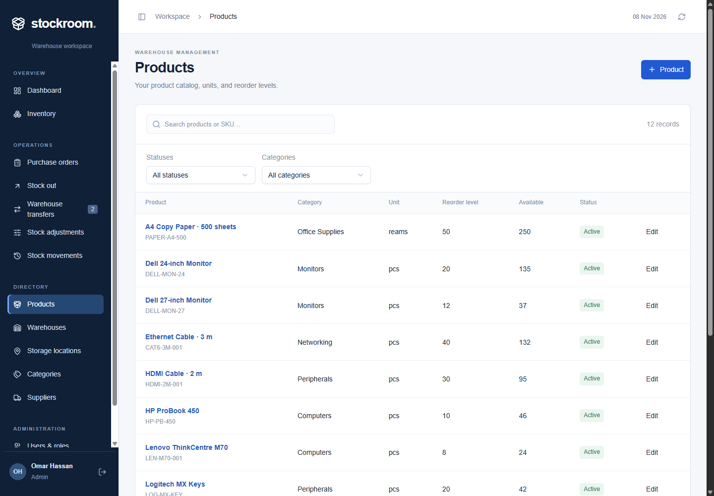
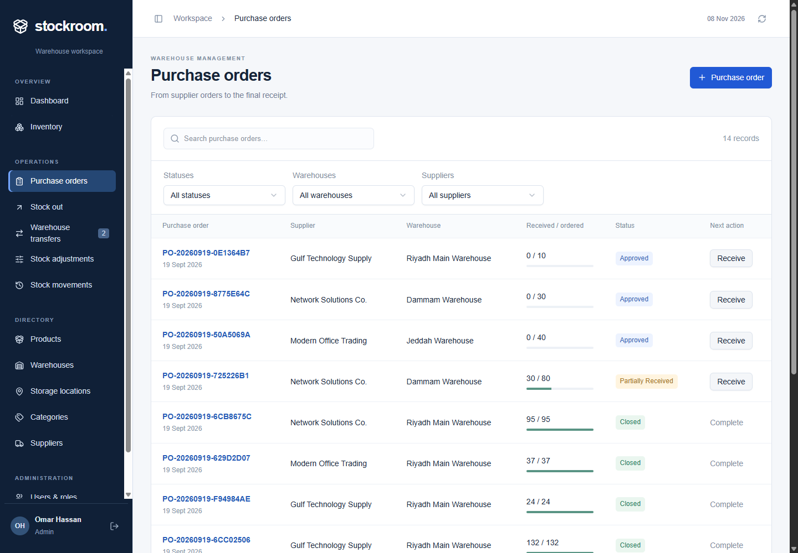
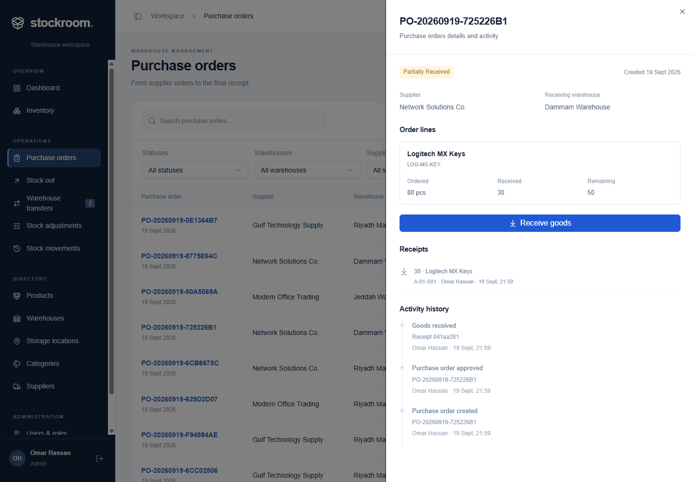
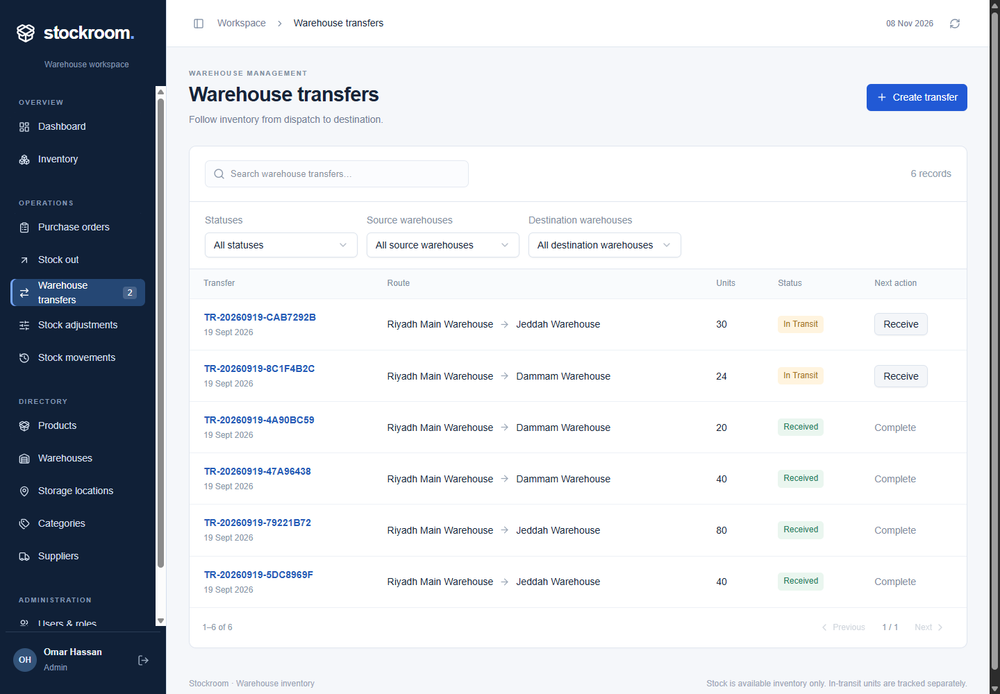
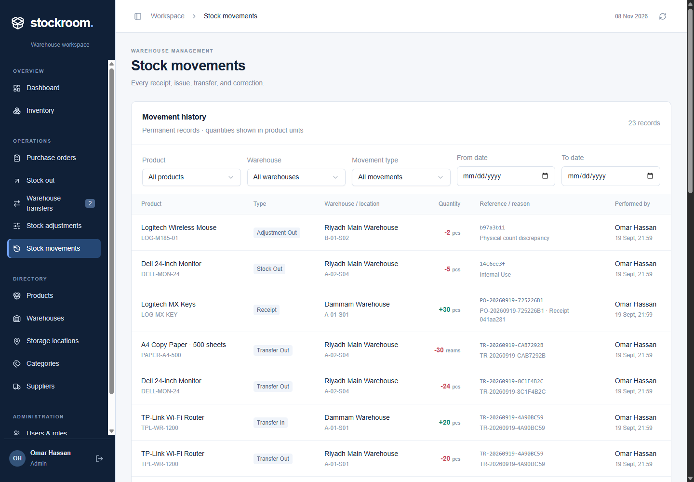
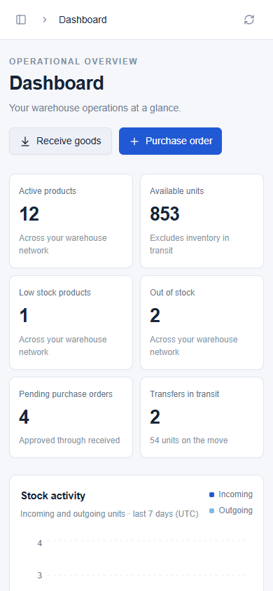

# Stockroom

A warehouse inventory application for managing stock, purchasing, transfers, and warehouse activity.



## Features

- Admin, Warehouse Manager, and Warehouse Staff accounts with server-side permissions.
- Warehouses, storage locations, products, categories, and suppliers.
- Purchase order approval, partial goods receipts, and order closing.
- Stock issues, adjustments, and warehouse transfers.
- Inventory totals, low-stock indicators, movement history, and activity records.
- Responsive dashboard, search, filters, and pagination.

## Screenshots

| Login | Inventory |
|---|---|
|  |  |

| Products | Purchase orders |
|---|---|
|  |  |

| Purchase order details | Warehouse transfers |
|---|---|
|  |  |

| Stock movements | Mobile dashboard |
|---|---|
|  |  |

Screenshots show the local application with fictional sample data. Desktop captures use 1440 × 1000; the mobile capture uses 390 × 844. A clean database starts empty.

## Technology

React, TypeScript, Vinext/Vite, Tailwind CSS, shadcn/ui, Cloudflare Workers, and D1 (SQLite). Drizzle describes the database schema and generates migrations.

The frontend and backend use separate source folders and run together as one application. Install dependencies and run commands from the project root.

See [Architecture and database design](docs/architecture.md) for system diagrams, the ERD, authentication, role permissions, workflow rules, and data integrity.

## Run locally

Requirements: Node.js 22.13 or later and npm. The test suite uses Node's built-in SQLite module; Node.js 24 is recommended for development.

```sh
npm ci
npm run build
```

For a **new, empty local database**, apply the initial migration once:

```sh
node --import ./scripts/sites-env.mjs ./node_modules/wrangler/bin/wrangler.js d1 execute DB --local --config dist/server/wrangler.json --persist-to .wrangler/state --file migrations/0000_striped_speed_demon.sql
```

Start the development server:

```sh
npm run dev
```

Open `http://localhost:5173`. Sign in, or create an administrator account if the database has no users. Then add warehouses, storage locations, products, and users. No default account or password is provided. Complete account setup before exposing a new instance to other users.

Existing local data lives in `.wrangler/state`. Keep that folder when updating the source, and apply only migrations that have not already run. Local development does not require cloud credentials.

To serve the compiled Worker locally, run `npm run build` followed by `npm start`.

## Project structure

```text
stockroom/
├── frontend/       UI, browser API client, styles, and assets
├── backend/        HTTP handlers, authentication, business rules, and database schema
├── tests/          Business-rule regression tests
├── migrations/     SQL migrations and Drizzle metadata
├── shared/         Types shared by the frontend and backend
├── docs/
│   ├── architecture.md  System diagrams, ERD, permissions, and business rules
│   └── screenshots/     Actual desktop and mobile interface captures
├── app/            Five small framework entry points
├── scripts/        Development, testing, installation, and build tools
└── README.md
```

The root also contains dependency manifests and configuration for Vite, TypeScript, Tailwind, ESLint, shadcn/ui, and Drizzle. Framework entry points in `app` delegate to `frontend/src/app` and `backend/src/routes`.

Generated dependencies, build output, test bundles, local tool state, environment files, and local databases are excluded by `.gitignore`. They are not part of the source uploaded to GitHub. The initial migration is included so a clean clone can create its own database.

## Checks

```sh
npm test
npm run typecheck
npm run build
```

Tests use an isolated in-memory SQLite database with the real migrations. They cover permissions, stock balances, receipt and transfer workflows, rollback, concurrent updates, repeated requests, password hashing, sessions, and request-origin checks. Test bundles are generated in `tests/.generated` and are ignored by Git.

Generate a new migration after changing the schema:

```sh
npm run db:generate
```

Review generated migrations before applying them. Keep previously applied migration files unchanged.

## Data and access

Quantities are stored as integer thousandths. Atomic database batches, constraints, request IDs, and version checks protect stock updates. Movement and activity records are immutable.

Passwords use salted PBKDF2 hashes. Server sessions use hashed tokens and HttpOnly cookies. Protected operations validate the current account, role, and request origin.

## Scope

Catalog and operational pages paginate a loaded workspace snapshot; history is paginated on the server. Orders and transfers accept up to 20 lines. Transfers are received in full.

## Future improvements

Potential additions include server pagination for catalog and operational pages, partial transfer receipts, email password recovery, MFA, supplier delivery tracking, data exports, lot/serial tracking, and accounting/payment integrations.
