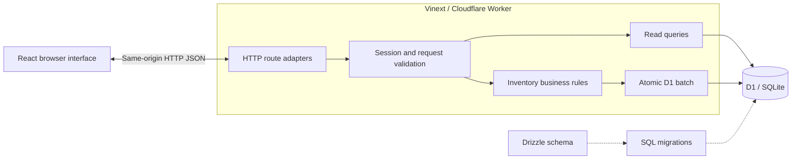
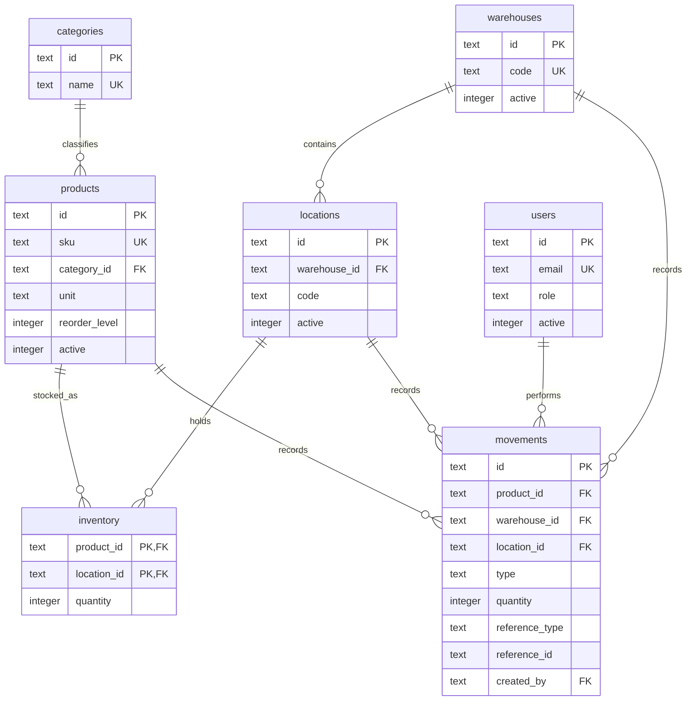
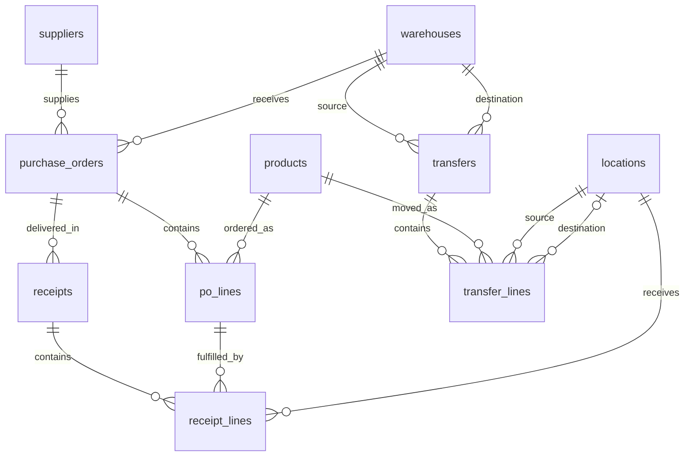
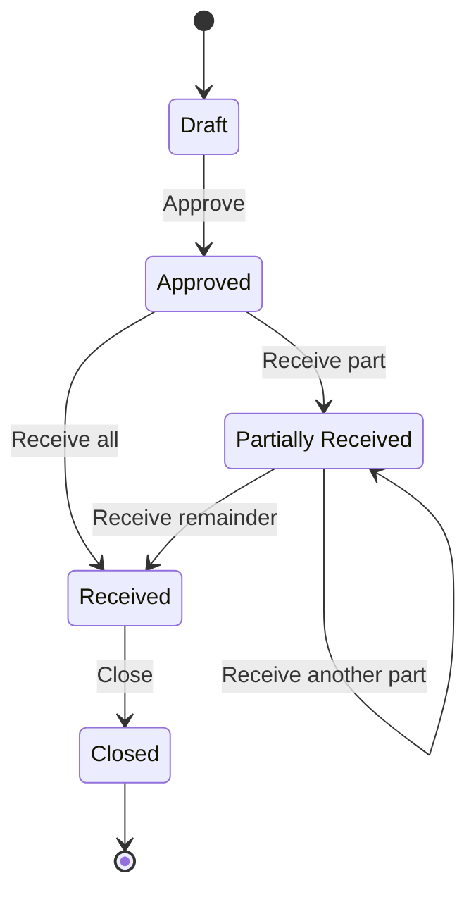
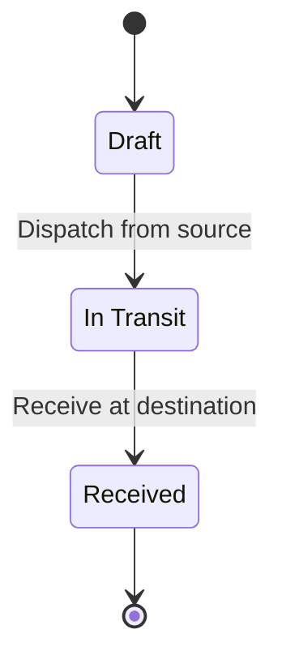

# Architecture and database design

[Back to the project overview and screenshots](../README.md).

## System architecture

Stockroom runs as one application. Vinext provides the React rendering and file-based route handling; the Cloudflare Vite plugin runs the Worker and a local D1 database during development. The interface and `/api` share an origin. There is one dependency installation and one development server, started from the repository root.

Runtime database access uses D1 prepared SQL statements and batches. Drizzle describes the schema and generates migrations; it is not the runtime query layer. Local development uses Wrangler/Miniflare state in `.wrangler/state` and does not need a deployed cloud database.

## Source boundaries

| Location | Responsibility |
|---|---|
| `frontend/src/app` | Root page, layout, metadata, and stylesheet entry |
| `frontend/src/pages/Workspace.tsx` | Login, navigation, dashboard, records, and detail views |
| `frontend/src/components` | Stock operation forms, tables, dialogs, and shared UI components |
| `frontend/src/services/api.ts` | Browser JSON requests and error handling |
| `backend/src/routes` | Authentication, read, and mutation HTTP handlers |
| `backend/src/auth` | Password hashing, login throttling, sessions, cookies, and request checks |
| `backend/src/services` | Master data, purchasing, transfers, stock operations, queries, and transaction guards |
| `backend/src/validation` | Input validation and application errors |
| `backend/src/db` | D1 binding access and Drizzle schema |
| `shared/types` | Shared actor and record types |
| `migrations` | SQL schema history, integrity triggers, and Drizzle metadata |
| `tests` | Regression tests using isolated SQLite databases |
| `app` | Five framework entry points that delegate to the frontend and backend |

The root `app` directory contains two UI entry points and three API entry points. These adapters allow the framework to discover routes while keeping their implementation in the corresponding source folders. The frontend and backend folders are not independently deployed services.

## Database ERD

The diagrams show the main business relationships and selected columns. The complete 22-table schema is defined in [schema.ts](../backend/src/db/schema.ts); the initial [SQL migration](../migrations/0000_striped_speed_demon.sql) also defines the stock and audit triggers.

### Catalog and stock

Inventory has one row per `(product_id, location_id)`. Location codes are unique within their warehouse. Movement references use a `reference_type` and `reference_id` pair to identify the originating purchase order, transfer, issue, or adjustment; that pair is a logical reference rather than a foreign key to one table.

### Purchasing and transfers

Each purchase order line tracks ordered and received quantities. A receipt records one delivery and its destination locations. A transfer line keeps its source location; the destination location is set when the transfer is received. User foreign keys record who created, approved, dispatched, received, or closed the relevant operation.

### Supporting tables

| Tables | Purpose |
|---|---|
| `users`, `sessions`, `login_attempts` | Accounts, hashed session tokens, and per-email sign-in throttling |
| `stock_issues`, `adjustments` | Reason, quantity, product, location, and actor for outgoing stock and count corrections |
| `activities` | Immutable business and administrative activity records |
| `requests` | Request ownership, payload fingerprint, and result ID for idempotent mutations |
| `guards` | Constraint-backed assertions evaluated inside the write batch |
| `settings` | One-time workspace initialization marker |

## Authentication and permissions

On a new, empty database, the setup form creates the first administrator once. After initialization, administrators create additional accounts in Users & roles. No default credentials are shipped with the source.

- Passwords use PBKDF2-SHA512 with 100,000 iterations and a random 16-byte salt. Accepted passwords contain 12–128 characters.
- A successful login creates an opaque session token. Only its SHA-256 hash is stored in `sessions`; the session expires after 12 hours.
- The `stockroom_session` cookie is HttpOnly, SameSite=Strict, and Secure when the request uses HTTPS. The frontend does not store the session token in localStorage.
- Every protected request joins the session with the current active account. The server reads the role from the database. Mutation batches also recheck the actor's active status and role before committing.
- JSON mutations require `X-Stockroom: 1` and a JSON content type. When an Origin header is present, it must match the request origin.
- Logout deletes the session. An administrator's password reset deletes that user's sessions; role and active-state changes take effect through the live account check.
- Eight failed sign-in attempts for an email address block further attempts for the remainder of a 15-minute window.

| Capability | Admin | Warehouse Manager | Warehouse Staff |
|---|---|---|---|
| Read inventory, catalog, warehouses, suppliers, purchase orders, transfers, and movement history | Yes | Yes | Yes |
| Manage warehouse records and user accounts | Yes | No | No |
| Manage products, categories, suppliers, and storage locations | Yes | Yes | No |
| Create, approve, and close purchase orders | Yes | Yes | No |
| Receive approved purchase orders | Yes | Yes | Yes |
| Create and dispatch warehouse transfers | Yes | Yes | No |
| Receive transfers in transit | Yes | Yes | Yes |
| Issue stock with a reason | Yes | Yes | Yes |
| Make stock adjustments and view the full activity list | Yes | Yes | No |

All three roles can read all warehouses; there is no assignment of users to individual warehouses. Staff can see adjustment movements and the activity timeline of a record they can open. They cannot open the full administrative activity list or the user-management screen, and the workspace response omits the user directory for non-admins. Actor names remain visible in operational history.

Permissions are enforced by backend services as well as interface controls. Administrators cannot deactivate themselves or remove their own administrator role. Workflow and stock constraints apply to every role.

## Purchase order workflow

Creation accepts 1–20 lines with distinct, active products and positive quantities. Approval requires an active supplier, warehouse, and products. Receiving is allowed only for Approved or Partially Received orders. Each received line must belong to the order, stay within its outstanding quantity, and use an active location in the order's warehouse. Receipt records, line totals, stock movements, status changes, and activity records commit together. Only a fully received order can close.

## Transfer workflow

Source and destination warehouses must differ. A draft validates stock availability but does not reserve or deduct stock. Dispatch rechecks available balances and creates negative `TRANSFER_OUT` movements. While the transfer is In Transit, its quantity is tracked separately from available stock. Receipt requires every line at its full quantity, with active locations in the destination warehouse, and creates positive `TRANSFER_IN` movements. Partial transfer receipt is not implemented.

## Stock integrity and concurrency

Quantities use integer thousandths: `1.250` units is stored as `1250`. The API validates up to three decimal places, and the interface converts stored values back to display units.

Stock changes are recorded as signed movements. An SQL trigger applies each movement to the corresponding inventory balance. A nonnegative balance constraint prevents overspending, and another trigger checks that a movement's location belongs to its warehouse. SQL triggers reject updates and deletes of movement and activity records.

Every business mutation requires a `request_id`. The server stores its actor, payload fingerprint, and result in the same batch as the operation. Repeating the same request returns the stored result; reusing its ID for another actor or payload is rejected.

Optimistic version checks protect master-data edits and workflow transitions. Constraint-backed transaction guards recheck versions, active records, permissions, and available balances inside the atomic D1 batch. A failing statement rolls back the batch, including stock movements, document updates, request records, and audit entries. Prepared statements bind external values; service code restricts dynamic table names to supported entities.

Stock issues and adjustments require a reason. Direct quantity edits are not exposed by the master-data API. Deactivation preserves history, with checks for remaining stock and transfers where applicable.

## API surface

| Method | Endpoint | Purpose |
|---|---|---|
| GET | `/api/auth` | Current account and whether initial setup is required |
| POST | `/api/auth` | `setup`, `login`, or `logout` |
| GET | `/api/data` | Workspace snapshot, inventory totals, and dashboard data |
| GET | `/api/data?kind=history` | Movement history with filters and server pagination |
| GET | `/api/data?kind=activity` | Manager/Admin activity list with server pagination |
| GET | `/api/data?kind=detail&entity=...&id=...` | Supported record details and activity timeline |
| POST | `/api/action` | Validated master-data or stock workflow action |

Mutation actions are `save_master`, `create_po`, `approve_po`, `receive_po`, `close_po`, `create_transfer`, `dispatch_transfer`, `receive_transfer`, `stock_out`, and `adjust`. All require authentication and the appropriate role. Read responses use `Cache-Control: no-store`.

Application errors use `{ "error": "message" }`: 400 for invalid inputs or workflow rules, 401 for missing/expired sessions, 403 for denied permissions or request checks, 404 for missing records, 409 for conflicting state, and 429 for login throttling. Unexpected storage failures return a generic 503 response.

## Queries, interface, and calculations

The workspace snapshot loads catalog and operational collections together. Their search, filters, and pagination run in the browser. Movement and full activity histories are queried separately in pages of 25 rows. The dashboard includes eight recent movements and a seven-day movement trend grouped by UTC date.

- Available stock is the sum of balances at storage locations; it excludes transfers in transit.
- Low stock means an active product has a positive available balance at or below its reorder level. Out of stock means its available balance is zero.
- Pending purchase orders include Approved, Partially Received, and Received orders until they are closed.
- Stock distribution is grouped by warehouse; operational timestamps are stored as ISO UTC strings and displayed in browser local time.

The interface uses hash-based section navigation inside `Workspace.tsx`, shared forms, Radix/shadcn dialogs and sheets, tables, toasts, and Recharts. On small screens, the sidebar becomes a drawer and tables scroll within their containers. Actual interface captures are in [screenshots](screenshots/), with a gallery in the [README](../README.md#screenshots).

## Migrations and local state

Run the initial migration only for a new, empty local database, using the commands in the [setup guide](../README.md#run-locally). Keep applied SQL files unchanged and add a new migration for later schema changes. Preserve Drizzle's `meta` files so future schema generation has its baseline.

`.wrangler/state` holds the existing local database. It is ignored by Git, as are dependencies, build output, generated test bundles, environment files, and framework caches. The repository includes schema migrations and screenshot assets, not the local database or its account credentials.

## Verification and scope

`npm test` bundles the service entry points and runs 34 regression tests with Node's test runner, an isolated in-memory SQLite database, a D1-like adapter, and the real SQL migration. The suite covers authorization, purchasing, transfers, stock conservation, rollback, stale and concurrent writes, overlapping retries, JSON request validation, idempotency, password hashing, sessions, and request-origin checks. It is a domain regression suite rather than a complete HTTP or browser test suite. TypeScript and production build checks are available through `npm run typecheck` and `npm run build`.

Most screens share one workspace component and use general record types. Larger datasets would benefit from server pagination across more collections. Email recovery, MFA, accounting, payments, supplier delivery tracking, exports, lot/serial tracking, and partial transfer receipts are outside the implemented scope. Cloud deployment configuration and operations are not covered by the local setup instructions.
